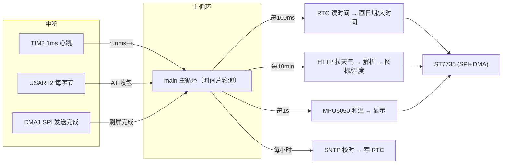
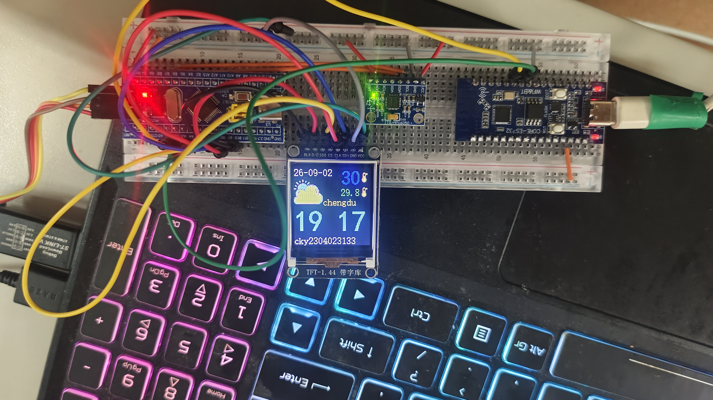

# Smart-Weather-Clock-1
基于STM32的声控LED交互系统项目
基于 **STM32F103C8T6** 打造的桌面天气时钟：本地走时 + WiFi 自动校时 + 网络天气 + 室内测温，实时显示在 TFT 彩屏上。
- 硬件主控：STM32F103C8T6（标准外设库，C 语言）
- 无线网络：ESP32-C3（乐鑫 AT 固件，串口驱动）
- 显示：TFT-LCD（ST7735 驱动 SPI 彩屏）
---

## 功能特性

- ✅ 实时时钟：日期 + 时分显示，秒跳、冒号闪烁
- ✅ 网络自动校时：SNTP 每小时校准（北京时间 UTC+8）
- ✅ 网络天气：心知天气 API，每 10 分钟自动刷新
- ✅ 天气图标：晴 / 云 / 雨 / 雪 / 阴 / 风（48×48 RGB565 图标）
- ✅ 室内测温：MPU6050 片上温度（软件 I2C）
- ✅ 开机自检：启动过程逐步提示，失败红字定位
- ✅ 自定义界面：地点显示、温度图标、底部标识

## 硬件需求（购买链接仅供参考）

| 硬件 | 说明 | 链接 |
|---|---|---|
| **STM32F103C8T6 最小系统板** | 主控（江协科技 STM32 入门套件） | [淘宝购买](https://e.tb.cn/h.8qWuWrWjA5ysQzf?tk=pRsVThIBCoS) |
| **TFT-LCD 彩屏（ST7735）** | SPI 串口屏（1.8/1.44/2.4/2.8 寸可选） | [淘宝购买](https://e.tb.cn/h.8qWujlZo54z52uF?tk=ec2JThIzsqS) |
| **ESP32-C3 开发板** | WiFi/蓝牙无线模块（烧乐鑫 AT 固件） | [淘宝购买](https://e.tb.cn/h.8LyCxBlstrrKner?tk=EB6tThIyffK) |
| MPU6050 模块（可选） | 室内温度来源（软件 I2C） | 自行选购 |
| 面包板 / 杜邦线 / 3.3V 电源 | 连接与供电 | 自行选购 |

> 以上链接仅作硬件选型参考，非商业推广；购买前请自行核对型号与价格。

## 硬件连接

### STM32F103C8 ↔ ESP32-C3（USART2，115200）

| STM32 | ESP32-C3（AT 固件 UART1） | 说明 |
|---|---|---|
| PA2 (USART2_TX) | GPIO6 (UART1_RX) | 指令发送 |
| PA3 (USART2_RX) | GPIO7 (UART1_TX) | 数据接收 |
| GND | GND | 共地 |

> 要点：必须接 ESP32 的 **GPIO6/GPIO7（UART1）**，不是 `RX0/TX0`（UART0 仅用于烧录/日志）；热点请用 **2.4GHz**（ESP32-C3 不支持 5GHz）。

### STM32F103C8 ↔ ST7735（SPI1）

| STM32 | ST7735 | 说明 |
|---|---|---|
| PA5 | SCL/SCK | SPI 时钟 |
| PA7 | SDA/MOSI | SPI 数据 |
| PA4 | CS | 片选（低有效） |
| PB1 | DC | 数据/命令 |
| PB10 | BLK | 背光 |
| GND | GND / 不接 RES | 模块无硬件 RES，代码用软件复位 |

### STM32F103C8 ↔ MPU6050（软件 I2C）

| STM32 | MPU6050 |
|---|---|
| PB6 | SCL |
| PB7 | SDA |
| 3.3V / GND | VCC / GND |

## 软件架构



- `app/`：业务层（`main.c` 主循环 / `weather.c` JSON 解析 / 字体 / 图标）
- `driver/`：驱动层（`st7735` 屏幕 / `esp-at` 无线 / `rtc` / `timer` / `mpu6050` / `led`）
- `firmware/`：STM32F1 标准外设库
- `mdk/`：Keil MDK 工程

## 快速开始

1. **烧录 ESP32-C3 AT 固件**：使用乐鑫官方 ESP-AT（esp32c3 版本），确认 `AT` 返回 `OK`。
2. **接线**：按上文连接 STM32 / ESP32-C3 / 屏幕（记得共地、3.3V 供电）。
3. **配置**：修改 `app/main.c` 顶部的 WiFi 账号密码、城市与天气 API Key：
   ```c
   static const char *wifi_ssid    = "你的WiFi";
   static const char *wifi_password = "你的密码";
   static const char *city_name    = "chengdu";   // 显示地点
   static const char *weather_uri  = "https://api.seniverse.com/v3/weather/now.json?key=你的KEY&location=chengdu&language=en&unit=c";
   ```
4. **编译烧录**：Keil 打开 `mdk/stm32f103.uvprojx` → F7 编译 → F8 烧录（ST-Link SWD：SWDIO/SWCLK/GND/3.3V）。
5. 上电后屏幕依次提示 `Initializing → Wait ESP32 → Ready` 即联网成功。

## 目录结构（简）

```
├── app/               # 主程序、天气解析、字体、天气图标
├── driver/            # ST7735 / esp-at / rtc / timer / mpu6050 驱动
├── firmware/          # STM32F1 标准外设库
├── mdk/               # Keil 工程
├── icon/              # 自定义图标（图片素材等）
├── README.md
└── 智能天气时钟_代码全解析.md   # 全代码逐行解析文档
```

## 演示


## 免责声明

- 天气数据来自第三方公开 API，接口与字段可能变更，请以实际为准。

  
---
**技术栈**：`STM32F103C8` `C` `标准外设库` `SPI+DMA` `ST7735` `USART/中断` `软件I2C` `RTC/SNTP` `ESP32-AT` `HTTP/JSON`
