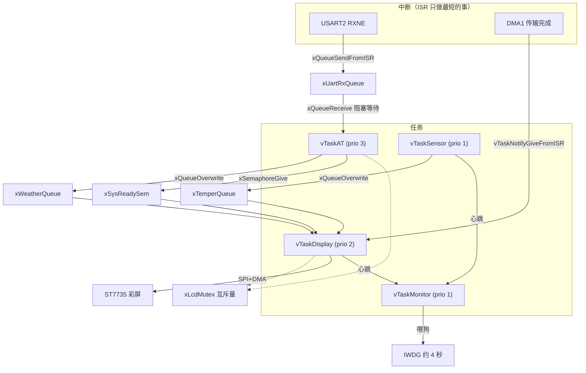

# 基于 STM32F103C8 + Freertos的智能天气时钟

基于 **STM32F103C8T6** 打造的桌面天气时钟：本地走时 + WiFi 自动校时 + 网络天气 + 室内测温，实时显示在 TFT 彩屏上。

- 硬件主控：STM32F103C8T6（标准外设库，C 语言）
- 无线网络：ESP32-C3（乐鑫 AT 固件，串口驱动）
- 显示：TFT-LCD（ST7735 驱动 SPI 彩屏）

> 屏幕尺寸说明：本工程代码按 **128×128（1.44 寸）ST7735** 调试；若你使用 2.4 寸等其它尺寸，需同步修改 `driver/st7735/st7735.h` 中的 `ST7735_WIDTH / HEIGHT / XSTART / YSTART`。

---

## 功能特性

-  实时时钟：日期 + 时分显示，秒跳、冒号闪烁
-  网络自动校时：SNTP 每小时校准（北京时间 UTC+8）
-  网络天气：心知天气 API，每 10 分钟自动刷新
-  天气图标：晴 / 云 / 雨 / 雪 / 阴 / 风（48×48 RGB565 图标）
-  室内测温：MPU6050 片上温度（软件 I2C）
-  开机自检：启动过程逐步提示，失败红字定位
-  自定义界面：地点显示、温度图标、底部标识
-  **FreeRTOS 多任务**：AT / 显示 / 传感器 / 监控 4 个任务，队列传递数据
-  **可靠性设计**：联网失败自动重试（不再死机）、看门狗 + 任务心跳兜底复位

## 硬件需求（购买链接仅供参考）

| 硬件 | 说明 | 链接 |
|---|---|---|
| **STM32F103C8T6 最小系统板** | 主控（江协科技 STM32 入门套件） | [淘宝购买](https://e.tb.cn/h.8qWuWrWjA5ysQzf?tk=pRsVThIBCoS) |
| **TFT-LCD 彩屏（ST7735）** | SPI 串口屏（1.8/1.44/2.4/2.8 寸可选） | [淘宝购买](https://e.tb.cn/h.8qWujlZo54z52uF?tk=ec2JThIzsqS) |
| **ESP32-C3 开发板** | WiFi/蓝牙无线模块（烧乐鑫 AT 固件） | [淘宝购买](https://e.tb.cn/h.8LyCxBlstrrKner?tk=EB6tThIyffK) |
| MPU6050 模块（可选） | 室内温度来源（软件 I2C） | 自行选购 |
| 面包板 / 杜邦线 / 3.3V 电源 | 连接与供电 | 自行选购 |

> 以上链接仅作硬件选型参考，非商业推广；购买前请自行核对型号与价格。

## 硬件连接

### STM32F103C8 ↔ ESP32-C3（USART2，115200）

| STM32 | ESP32-C3（AT 固件 UART1） | 说明 |
|---|---|---|
| PA2 (USART2_TX) | GPIO6 (UART1_RX) | 指令发送 |
| PA3 (USART2_RX) | GPIO7 (UART1_TX) | 数据接收 |
| GND | GND | 共地 |

> 要点：必须接 ESP32 的 **GPIO6/GPIO7（UART1）**，不是 `RX0/TX0`（UART0 仅用于烧录/日志）；热点请用 **2.4GHz**（ESP32-C3 不支持 5GHz）。

### STM32F103C8 ↔ ST7735（SPI1）

| STM32 | ST7735 | 说明 |
|---|---|---|
| PA5 | SCL/SCK | SPI 时钟 |
| PA7 | SDA/MOSI | SPI 数据 |
| PA4 | CS | 片选（低有效） |
| PB1 | DC | 数据/命令 |
| PB10 | BLK | 背光 |
| GND | GND / 不接 RES | 模块无硬件 RES，代码用软件复位 |

### STM32F103C8 ↔ MPU6050（软件 I2C）

| STM32 | MPU6050 |
|---|---|
| PB6 | SCL |
| PB7 | SDA |
| 3.3V / GND | VCC / GND |

## 软件架构（FreeRTOS 多任务）

### 任务划分

| 任务 | 优先级 | 栈 | 职责 |
|---|---|---|---|
| `vTaskAT` | 3（最高） | 320 字 | 联网初始化、HTTP 拉天气、SNTP 校时 |
| `vTaskDisplay` | 2 | 192 字 | **唯一的屏幕绘制者**：100ms 刷新日期/时间，消费温度/天气队列 |
| `vTaskSensor` | 1 | 128 字 | 每秒读 MPU6050 温度 |
| `vTaskMonitor` | 1 | 128 字 | 看门狗喂狗（检查任务心跳） |

### RTOS 通信机制

| 机制 | 对象 | 用途 |
|---|---|---|
| **队列** | `xUartRxQueue`(256B) | USART2 中断入队 → AT 任务出队组包 |
| **队列** | `xTemperQueue` / `xWeatherQueue`（长度 1） | 传感器/AT 任务 → 显示任务（只保留最新值，用 `xQueueOverwrite`） |
| **互斥量** | `xLcdMutex` | 保护 SPI 屏幕（AT 任务写引导信息、显示任务刷主界面） |
| **二值信号量** | `xSysReadySem` | AT 任务联网完成 → 通知显示任务进入主界面 |
| **任务通知** | DMA 完成中断 | 唤醒正在等待刷屏完成的任务（替代忙等） |



### 可靠性设计

- **联网失败自动重试**：失败时清屏提示 `Connect failed, retry...`，5 秒后重试；期间显示/传感器任务照常运行（裸机版会 `while(1)` 卡死）。
- **看门狗 + 任务心跳**：显示/传感器任务各自递增心跳，监控任务确认两者都在推进才喂狗（IWDG 约 4 秒超时）；任一任务卡死 → 系统自动复位。
- **启动宽限期**：监控任务前 3 秒无条件喂狗，避免开机阶段误复位。
- **调度方式**：所有周期任务用"下次执行时刻"法（`vTaskDelayUntil` / 比较 tick），避免首次延迟与周期漂移。

### FreeRTOS 移植要点（踩坑记录）

| 问题 | 解决方案 |
|---|---|
| 缺 `FreeRTOSConfig.h` | 新增 `app/FreeRTOSConfig.h`（72MHz / 1ms tick / 6KB 堆 / Cortex-M3 中断优先级宏） |
| 移植层用错内核 | 必须用 **RVDS/ARM_CM3** 的 `port.c`（不是 CM4F） |
| 异常处理重复定义 | `stm32f10x_it.c` 里注释掉 `SVC_Handler/PendSV_Handler/SysTick_Handler`，由内核提供 |
| `delay_us/delay_ms` 破坏 SysTick 节拍 | 按"调度器是否已启动"分流，任务中用 `vTaskDelay` / DWT 延时 |
| 链接报 `Undefined symbol vTaskDelay` | FreeRTOS 的 `INCLUDE_xxx` 宏默认是 0，用到的 API 必须显式置 1 |
| 看门狗开机反复复位 | 等待期间推进心跳 + 启动宽限期 + 超时放宽到 4 秒 |

### 目录结构

- `app/`：业务层（`main.c` 多任务 / `FreeRTOSConfig.h` 内核配置 / `delay.c` RTOS 兼容延时 / `weather.c` / 字体 / 图标）
- `driver/`：驱动层（`st7735` 屏幕 / `esp-at` 无线 / `rtc` / `timer` / `mpu6050` / `led`）
- `third_lib/freertos/`：FreeRTOS 内核（V10.4.3 LTS + `portable/` 下的 CM3 移植层）
- `firmware/`：STM32F1 标准外设库
- `mdk/`：Keil MDK 工程

## 快速开始

1. **烧录 ESP32-C3 AT 固件**：使用乐鑫官方 ESP-AT（esp32c3 版本），确认 `AT` 返回 `OK`。
2. **接线**：按上文连接 STM32 / ESP32-C3 / 屏幕（记得共地、3.3V 供电）。
3. **配置**：修改 app/main.c 顶部的 WiFi 账号密码、城市与天气 API Key：
   ```c
   static const char *wifi_ssid    = "你的WiFi";
   static const char *wifi_password = "你的密码";
   static const char *city_name    = "chengdu";   // 显示地点
   static const char *weather_uri  = "https://api.seniverse.com/v3/weather/now.json?key=你的KEY&location=chengdu&language=en&unit=c";
   ```
4. **编译烧录**：Keil 打开 mdk/stm32f103.uvprojx → F7 编译 → F8 烧录（ST-Link SWD：SWDIO/SWCLK/GND/3.3V）。
5. 上电后屏幕依次提示 Initializing → Wait ESP32 → Ready 即联网成功。

## 编译与调试注意

1. **FreeRTOS 内核已包含在工程中**（third_lib/freertos），Keil 工程的 include 路径与源文件都已配好，直接 **Rebuild** 即可。
2. **用到的 FreeRTOS API 必须在 app/FreeRTOSConfig.h 里使能**：INCLUDE_vTaskDelay、INCLUDE_vTaskDelayUntil、INCLUDE_xTaskGetSchedulerState等**默认值是 0**，漏了会报 Undefined symbol。
3. **调试时建议先关看门狗**：把 main.c 里的 #define USE_WATCHDOG 1 改成 0（IWDG 超时约 4 秒，单步调试停在断点会被复位）。
4. **RAM 余量**：STM32F103C8 只有 20KB RAM，configTOTAL_HEAP_SIZE 当前为 6KB；若任务创建失败（返回 pdFAIL），调小堆或缩小任务栈。
5. **源文件编码**：统一为 UTF-8 with BOM，Keil 与 VS Code 都能正确显示中文注释。

## 演示


## 声明

- 项目仅供学习交流，购买链接仅供参考。
- 天气数据来自第三方公开 API，接口与字段可能变更，请以实际为准。

---

**技术栈**：`STM32F103C8` `C` `标准外设库` `FreeRTOS` `队列/信号量/互斥量/任务通知` `SPI+DMA` `ST7735` `USART/中断` `软件I2C` `RTC/SNTP` `ESP32-AT` `HTTP/JSON` `IWDG 看门狗`


